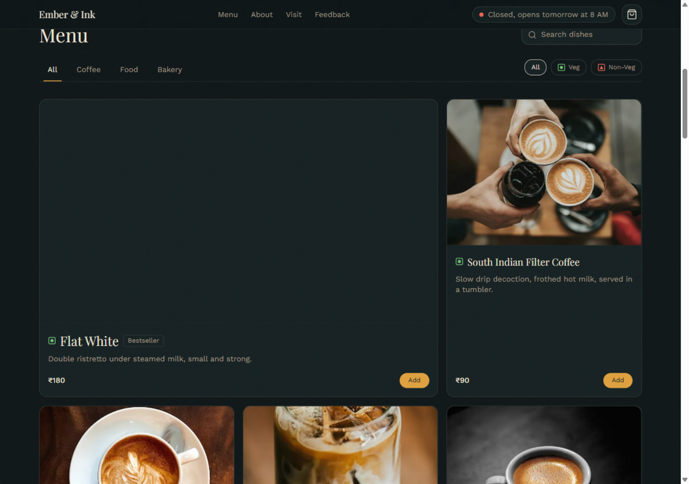

<div align="center">


# Ember & Ink

**Speciality coffee house — menu, cart, receipts and pickup orders.**

[](https://cafe-website-murex-seven.vercel.app)


**[Live site](https://cafe-website-murex-seven.vercel.app)** · [Docs](docs) · [Report an issue](https://github.com/Avani376/cafe-website/issues)

</div>

---

<div align="center">



</div>

## Features

- **Menu** — categories with tab filters, search results grouped by category, veg / non-veg marks, sold-out states, item sheets with options
- **Cart** — persists across reloads, dine-in or pickup, table number, notes, pickup slots computed from real opening hours
- **Payments** — Razorpay-ready behind a `PaymentProvider` interface; a labelled sandbox simulates Checkout end to end (signature-verified, idempotent)
- **Receipts** — printable per-order receipt page; dine-in orders prompt the customer to confirm their table at the counter
- **Order lookup & history** — find any order by number, reorder from on-device history with one tap
- **Feedback** — emoji rating scale, honeypot + rate limiting, stored and emailed
- **Craft** — "Ember After Dark" theme with verified AA contrast, gallery marquee, scroll reveals, fly-to-cart motion, reduced-motion safe throughout
- **PWA & SEO** — installable (manifest + icon), JSON-LD for the café and full menu, sitemap, robots, Open Graph

## Stack

Next.js 16 (App Router) · TypeScript strict · Tailwind CSS 4 (tokens as CSS variables) · motion · Zustand · Zod · SQLite via Drizzle · Vitest · Vercel

## Quick start

```sh
npm install
cp .env.example .env.local   # set PAYMENT_MOCK=true for sandbox payments
npm run dev                  # → http://localhost:3000
```

| Variable                                                              | Purpose                                                     |
| --------------------------------------------------------------------- | ----------------------------------------------------------- |
| `PAYMENT_MOCK`                                                        | `true` enables the sandbox payment provider (no real money) |
| `RAZORPAY_KEY_ID` / `RAZORPAY_KEY_SECRET` / `RAZORPAY_WEBHOOK_SECRET` | Real Razorpay (test keys first)                             |
| `RESEND_API_KEY` / `NOTIFY_EMAIL`                                     | Order + feedback notifications (optional)                   |

Full list and rules: [.env.example](.env.example) · [docs/payments.md](docs/payments.md)

## Scripts

`dev` · `build` · `start` · `lint` · `type-check` · `test` · `format`

## Deployment

Deployed on Vercel from this repo. To redeploy:

```sh
npx vercel deploy --prod --yes
```

Environment variables are set in Vercel Project Settings. On serverless, orders run in `/tmp` (per-instance, ephemeral) — swap to Supabase Postgres via `lib/db.ts` before real traffic: [docs/payments.md](docs/payments.md).

## Structure

```
app/          page · api/orders · api/payments · api/webhooks · receipt
components/   Header · Hero · Menu · MenuCard · CartDrawer · FeedbackForm · GalleryStrip
content/      menu.json · site.json · copy.md   ← all copy, prices, hours, links live here
lib/          pricing · orders · payments/ · db · motion · hours
design/       tokens.md — the theme source of truth
docs/         PRD · payments · content-guide · screenshots
tests/        Vitest suites (pricing, signatures, idempotency, feedback, sandbox)
```

## Docs

[PRD](docs/PRD.md) — product spec · [Design tokens](design/tokens.md) — theme system · [Payments](docs/payments.md) — flow, sandbox and go-live checklist · [Content guide](docs/content-guide.md) — how to edit the menu, hours and copy

---

<div align="center">

<sub>Placeholder menu, copy and photos stand in for the owner's real content — swap them in <code>/content</code> and <code>/public</code> without touching any code.</sub>

</div>
